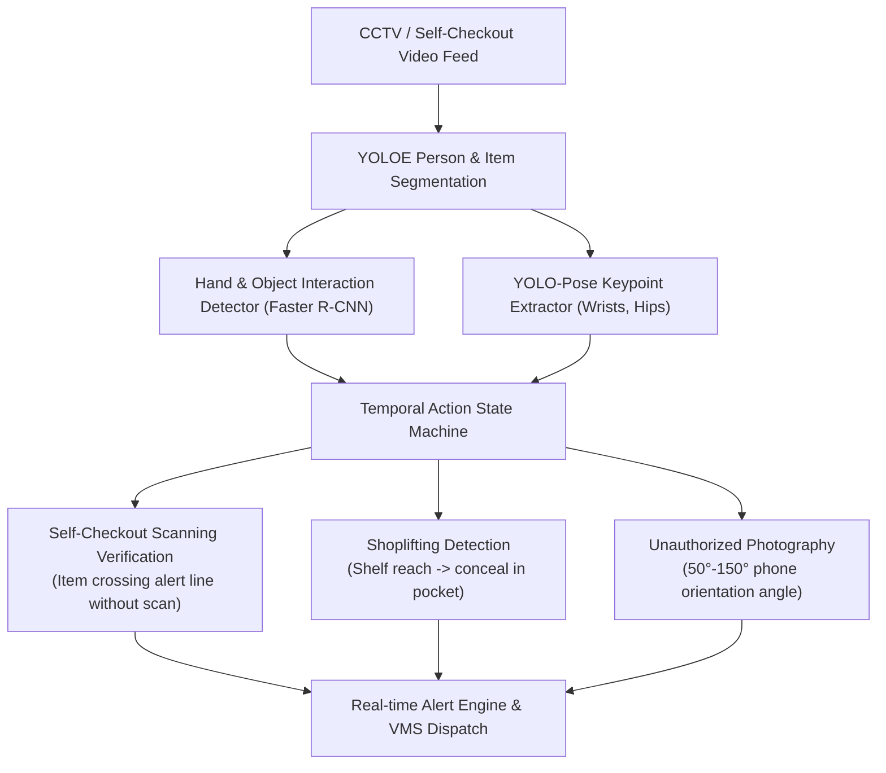

# Retail Loss Prevention Vision

[-76B900)](https://github.com/mh-masum6875/smart-retail-loss-prevention-ai)
[](https://github.com/mh-masum6875/smart-retail-loss-prevention-ai)
[](https://ultralytics.com/)
[](https://opensource.org/licenses/MIT)

An advanced computer vision framework for retail shrinkage prevention, self-checkout scanning verification, unauthorized photography detection, and temporal action recognition leveraging Vision Transformers.

---

## System Architecture



---

## Core Modules

### 1. Self-Checkout Unscanned Item Detector (`self_checkout_tracker.py`)
- **Multi-Model Fusion**: Integrates person segmentation, Faster R-CNN hand-object interaction detection, and wrist/fingertip trajectory state machines.
- **Scanning Zone Logic**: Defines virtual scanner polygons and alert boundaries. Immediately flags items moved into bagging areas without entering the active scanner sequence ($0.3\text{s}$ threshold).
- **False Alarm Suppression**: Phone handling detection suppresses false alerts when customers reach for mobile payments.

### 2. Shoplifting Action Recognition
- **Temporal Action Sequence**:
  $$\text{Idle} \longrightarrow \text{Hand in Shelf} \longrightarrow \text{Took Object} \longrightarrow \text{Hand to Pocket} \longrightarrow \text{Concealment Alert}$$
- **Pose & Wrist Geometry**: Tracks distance from wrist to shelf line ($<80\text{px}$) and wrist to hip pocket ($<15\text{px}$).
- **Research direction**: a graph-based skeleton tokenizer with a spatial-temporal transformer to model multi-frame theft behaviour, explored on the public PoseLift dataset.

### 3. Unauthorized Mobile Photography (`unauthorized_photo_detector.py`)
- **Phone Aspect Angle Calculation**: Classifies phone orientation angles between $50^\circ$ and $150^\circ$ as active camera holding positions.
- **Face & Chest Proximity**: Verifies phone elevation in the upper 60% of the torso bounding box.

---

## Quickstart

```bash
git clone https://github.com/mh-masum6875/smart-retail-loss-prevention-ai.git
cd smart-retail-loss-prevention-ai
pip install -r requirements.txt

# Run Self-Checkout Tracker Demo
python src/self_checkout_tracker.py --source sample_checkout.mp4

# Run Shoplifting Action Sequence Detector
python src/shoplifting_action_detector.py --source sample_retail.mp4
```

---

## License
This project is licensed under the MIT License.
